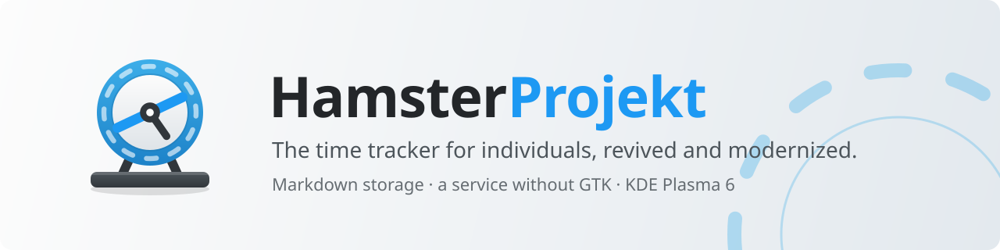

<picture>
  <source media="(prefers-color-scheme: dark)" srcset="https://raw.githubusercontent.com/HamsterProjekt/.github/main/assets/banner-dark.svg">
  
</picture>

# HamsterProjekt

**A revival and modernization of [Project Hamster](https://github.com/projecthamster/hamster), the time tracker for individuals.**

Hamster helps you keep track of how much time you spend on the activities you
choose to track. It is a good tool, but upstream development has slowed to a
crawl: the last release, 3.0.3, is from November 2023, and the project has
seen little maintenance since. This organization is a fork that aims to keep
Hamster alive and bring it up to date.

This is an independent fork. It is **not** an official Project Hamster
release, and it is not affiliated with or endorsed by the upstream
maintainers. All credit for Hamster itself goes to its original authors; see
[Credits](#credits).

## Repositories

| Repository | What it is | Forked from |
|---|---|---|
| [hamster](https://github.com/HamsterProjekt/hamster) | The Hamster service and GTK windows, plus a new storage backend that keeps everything in plain Markdown files and a service that runs without GTK | [projecthamster/hamster](https://github.com/projecthamster/hamster) |
| [hamster-kde](https://github.com/HamsterProjekt/hamster-kde) | A port of Hamster to KDE Plasma 6: a panel widget and Qt Quick / Kirigami windows | Inspired by upstream's [GNOME shell extension](https://github.com/projecthamster/hamster-shell-extension); new code |

## What is different from upstream

<table>
<tr>
<td width="56"></td>
<td><b>Markdown storage.</b> Facts, activities, categories and tags can live in
plain Markdown files instead of SQLite. You can read and edit them by hand,
and synchronise them between computers with whatever you already use.</td>
</tr>
<tr>
<td></td>
<td><b>A service that runs without GTK</b>, so other interfaces can sit on top of it.</td>
</tr>
<tr>
<td></td>
<td><b>KDE Plasma 6 support</b>, through the hamster-kde panel widget and windows.</td>
</tr>
<tr>
<td></td>
<td><b>Step-by-step installation instructions</b> (<code>INSTALL.md</code>) in both repositories.</td>
</tr>
<tr>
<td></td>
<td><b>Its own names.</b> The D-Bus services, settings schema and application ids
are <code>io.github.HamsterProjekt.*</code> instead of upstream's
<code>org.gnome.Hamster</code>, so the fork and upstream Hamster can be
installed side by side.</td>
</tr>
</table>

## What stays the same

<table>
<tr>
<td width="56"></td>
<td>We try hard not to break what already works:
<ul>
<li>SQLite stays the default storage; the Markdown backend is opt-in.</li>
<li>The GTK windows are untouched.</li>
<li>Hamster's data model, D-Bus methods and signals, and the
<code>activity@category, description, #tag</code> way of entering activities are unchanged.</li>
</ul>
A client of upstream Hamster works here once it uses the fork's D-Bus names
(<code>io.github.HamsterProjekt.Hamster</code> for <code>org.gnome.Hamster</code>).</td>
</tr>
</table>

## Relationship to upstream

We would rather see upstream thrive than fork forever. Changes that make sense
for everyone are kept small and separable, so they can be offered upstream.
The upstream history is preserved in our fork, and we keep an `upstream`
remote so that upstream fixes can be merged in.

If upstream becomes active again, we are happy to converge.

## Getting involved

Bug reports, patches and plain "this works on my distro" messages are all
welcome. See [CONTRIBUTING.md](https://github.com/HamsterProjekt/.github/blob/main/CONTRIBUTING.md).

## Credits

Hamster was written mainly by Toms Bauģis and Patryk Zawadzki, with
contributions from many others, and was later maintained by Eric Goller and the
[Project Hamster](https://github.com/projecthamster) community. We build on
their work and are grateful for it.

Hamster is licensed under the GNU GPL v3, and so are the repositories here.
